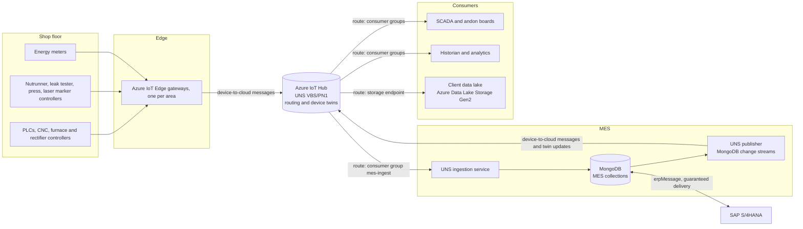

# Unified Namespace (UNS) design - VBS Chakan Plant Pune PN1

Version 7.0 | 28 July 2026 | Status: issued for reference | Decisions D081, D082, D083 (model changes applied 19 Oct 2026, model version 3.0)
Prepared for the Digital Factory MES (ClaudeMES project). Model version 2.9 (369 collections). Source data: the master data and sample documents in `03_design/*/samples`.

## 1. Purpose and scope

This document defines how the Digital Factory MES connects to a Unified Namespace at the reference site VBS Chakan Plant Pune PN1 (site `PN1`, `_id` 1003000000000001, enterprise `VBS` Varuna Brake Systems Pvt. Ltd., `_id` 1001000000000001). The UNS is built on Azure IoT Hub. It covers:

- the namespace tree, derived from the ISA-95 equipment hierarchy already held in master data (area, line, work center, equipment);
- the message types each piece of equipment and the MES send, with message class and where the current state is held;
- a payload sketch for every message type, with the MongoDB collection and keys each payload feeds;
- how the MES receives from and sends to the UNS, how the client data lake is kept in sync, what stays off the UNS, and security;
- the model changes the design needs (applied in model version 3.0), sample data findings that block a clean mapping, and assumptions.

Scope is the automotive reference product line at PN1: casting to final inspection of the Front Brake Caliper Assembly, LH. The pharmaceutical site Ranjangaon OSD Plant (`RJ1`) follows the same pattern under its own enterprise and site segments; it is out of scope for this version.

## 2. Role of the UNS in this architecture



- Azure IoT Hub is the only UNS platform. No third-party MQTT broker (HiveMQ, EMQX, Mosquitto or similar) and no other messaging middleware is used. Edge gateways run Azure IoT Edge and connect the controllers to IoT Hub; devices and gateways talk to IoT Hub over MQTT or AMQP, which are protocols of IoT Hub itself, not a separate broker.
- Equipment data enters the UNS once, at the edge, and any number of consumers read it through IoT Hub message routing and consumer groups.
- The MES is the largest consumer: it turns edge messages into execution, quality and performance records.
- The MES is also the source of context: it sends the current order, item, operation, recipe, unit, operator and shift for each work center, so that every other consumer receives machine data that is already labelled.
- Client data lake synchronisation: IoT Hub message routing writes every UNS message to the client data lake (Azure Data Lake Storage Gen2), in folders partitioned by date and hour. This covers machine data, MES context, business events, indicators and master data changes. Each message carries the ISA-95 path and the master `_id` values (section 6), so the data lake holds related machine, production and master data that can be joined without reading the MES database.
- ERP transactions and records of record do not travel through the UNS (section 9).

## 3. Design decisions

| No. | Decision | Reason |
|---|---|---|
| U1 | One Azure IoT Hub (Standard tier, Azure region Central India) is the UNS for PN1. No third-party MQTT broker or other messaging product is used. | Owner decision. IoT Hub is a managed Azure service with per-device identity, message routing, device twins and native routing to Azure storage. |
| U2 | The namespace follows ISA-95: enterprise / site / area / line / work center / equipment, using the master data `recordNo` of each level verbatim as the path segment. | The hierarchy already exists in `u_mes_mast_area`, `u_mes_mast_line`, `u_mes_mast_workCenter` and `u_mes_mast_equipment`; using `recordNo` makes every path traceable to one master document. |
| U3 | IoT Hub device topics are fixed, so the ISA-95 path travels as message properties: the MES writes the path into the device twin tags of each equipment identity, and IoT Hub message enrichment stamps it on every message. The path is not stored in any MongoDB document. | A device cannot change its own twin tags, so it cannot send under a wrong path; routing queries and the data lake can filter on the path; one source of truth. |
| U4 | One IoT Hub device identity per piece of equipment, named `PN1-<equipment recordNo>` (for example `PN1-TRQ-01-N1`), connected through the IoT Edge gateway of its area. One identity `PN1-MES` for the MES publisher. | Per-equipment identity gives per-equipment twins, connection state and access control. |
| U5 | Payloads are UTF-8 JSON with `contentType` application/json and `contentEncoding` utf-8, and one common envelope (section 6). | Required by IoT Hub to route on the message body; JSON is readable for the MES, the consumers and the data lake. |
| U6 | Three message classes: State, Event, Measurement. IoT Hub keeps no retained messages, so the current state is held in device twins: reported properties for equipment state, last tag values and active alarms; desired properties for the MES context of the work center; reported properties of `PN1-MES` for line context and indicators. History travels as device-to-cloud messages. | A late consumer reads the current state from the twin at once; events are never replayed as stale. |
| U7 | At-least-once delivery (MQTT QoS 1 or AMQP) for every message. Consumers are idempotent (section 8.3). | IoT Hub supports QoS 0 and 1; duplicates are removed by message id. |
| U8 | The payload timestamp carries its real offset (`+05:30`). The MES stores it as IST wall-clock digits with the `+0000` suffix, as DATA-004 requires. | The payload is unambiguous for every consumer; the database keeps its convention. |
| U9 | Numbers are plain JSON numbers. The ingestion service parses them losslessly from the raw text and stores Decimal128 for every Decimal128 key; Double only for `tagValue` and `powerFactor` (D009). | Matches D070: a plain number means Decimal128 unless the model says otherwise; no binary rounding of torque, pressure or leak values. |
| U10 | Writes to equipment (recipe download, tool program selection) stay on the direct OPC UA / Open Protocol path with checksum verification. IoT Hub cloud-to-device messages and direct methods are not used for equipment writes; the UNS only carries the result event. | Equipment writes must be acknowledged by the target and verified; a safety matter. |
| U11 | ERP messages, electronic signatures, genealogy writes and label printing stay off the UNS. | They need guaranteed, acknowledged, audited delivery (section 9). |
| U12 | The MES sends context from MongoDB change streams, not from application code paths. | Every change to the execution records reaches the UNS, whichever screen or service made it. |
| U13 | The client data lake is kept in sync by an IoT Hub route to an Azure Data Lake Storage Gen2 storage endpoint (JSON encoding, batches every 300 seconds), and the MES sends master data change messages so that the lake has the related dimensions. | No custom export jobs; the lake receives exactly what the UNS carries, with the same keys. |

## 4. Namespace structure

### 4.1 ISA-95 path

```
<enterprise>/<site>/<area>/<line>/<workCenter>/<equipment>
```

- Each level is the `recordNo` of the master document, exactly as stored (case-sensitive). All PN1 `recordNo` values use only `A-Z`, `0-9` and `-`, which are valid in IoT Hub device identity names and property values.
- A node can be described at its own level: a line path ends after `<line>`, a work center path after `<workCenter>`.
- Process tags are named by the last segment of `u_mes_perf_processTag.recordNo` (`PN1.GDC01.DIE_TEMP_UPPER` gives `DIE_TEMP_UPPER`).
- A line and its work center can carry the same `recordNo` (line `GDC-01`, work center `GDC-01`); the level position keeps them apart: `VBS/PN1/FDY/GDC-01/GDC-01`.

### 4.2 Message properties

| Property | Kind | Set by | Value |
|---|---|---|---|
| `isa95Path` | Enrichment | IoT Hub, from twin tag `isa95Path` of the sending identity | `VBS/PN1/ASY/ASY-01/TRQ-01/TRQ-01-N1`; `VBS/PN1` for `PN1-MES` |
| `siteRecordNo`, `areaRecordNo`, `lineRecordNo`, `workCenterRecordNo`, `equipmentRecordNo` | Enrichment | IoT Hub, from twin tags | `PN1`, `ASY`, `ASY-01`, `TRQ-01`, `TRQ-01-N1` |
| `equipmentId` | Enrichment | IoT Hub, from twin tag `equipmentId` | `1013000000000007` |
| `nodePath` | Application property | Sender, only when the message describes another node than the sender (MES messages) | `VBS/PN1/ASY/ASY-01/TRQ-01` |
| `ns` | Application property | Sender | `edge`, `mes` or `kpi` |
| `msgType` | Application property | Sender | For example `state`, `tag`, `result.tightening`, `context.workCenter` |
| `schema` | Application property | Sender | Same as the envelope `schema` |
| `message-id` | System property | Sender | Same as the envelope `msgId` |
| `contentType`, `contentEncoding` | System property | Sender | `application/json`, `utf-8` |

Seven enrichments are used (IoT Hub allows up to ten). A consumer finds the node of a message as `nodePath` when present, otherwise `isa95Path`.

### 4.3 Message types

| `ns` | Level | `msgType` | Class | Current state held in | Sent by |
|---|---|---|---|---|---|
| `edge` | Equipment | `state` | State | Twin reported property `state` of the equipment identity | IoT Edge gateway |
| `edge` | Equipment | `tag` | Measurement | Twin reported property `tags.<TAG>` | IoT Edge gateway |
| `edge` | Equipment | `alarm` | State | Twin reported property `activeAlarms.<alarmCode>` (removed when cleared) | IoT Edge gateway |
| `edge` | Equipment | `count` | Event | - | IoT Edge gateway |
| `edge` | Equipment | `result.<resultType>` | Event | - | IoT Edge gateway |
| `edge` | Equipment | `energy` | Event | - | IoT Edge gateway |
| `mes` | Work center | `context.workCenter` | State | Twin desired property `mesContext` of every equipment identity of the work center | MES publisher |
| `mes` | Line | `context.line` | State | Twin reported property `lineContext.<lineRecordNo>` of `PN1-MES` | MES publisher |
| `mes` | Work center, site | `event.<eventType>` | Event | - | MES publisher |
| `mes` | Site | `master.<entity>` | Event | - | MES publisher |
| `kpi` | Equipment | `oee` | State | Twin reported property `kpi.oee.<equipmentRecordNo>` of `PN1-MES` | MES publisher |
| `kpi` | Work center | `stationPerformance` | State | Twin reported property `kpi.stationPerformance.<workCenterRecordNo>` of `PN1-MES` | MES publisher |

Device connection and disconnection are not messages of the UNS payload standard; IoT Hub raises them as device connection state events, which are routed to the MES (section 7.16).

### 4.4 Routes

| Route | Source | Condition | Endpoint |
|---|---|---|---|
| `r-uns-events` | Device telemetry messages | `$contentType = 'application/json'` | Built-in endpoint `events`, consumer groups `mes-ingest`, `scada`, `historian`, `analytics` |
| `r-data-lake` | Device telemetry messages | `$contentType = 'application/json'` | Storage endpoint `ep-client-lake` (client Azure Data Lake Storage Gen2, container `uns-pn1`, JSON encoding, file name format `{iothub}/{YYYY}/{MM}/{DD}/{HH}/{mm}/{partition}`, batch frequency 300 seconds, chunk size 100 MB) |
| `r-connection-state` | Device connection state events | `true` | Built-in endpoint `events` (consumer group `mes-ingest`) |
| Fallback route | Messages matching no route | - | Disabled, so that no message bypasses the routing rules |

## 5. PN1 namespace tree

### 5.1 Tree

```
VBS                                             enterprise  1001000000000001  Varuna Brake Systems Pvt. Ltd.
└── PN1                                         site        1003000000000001  Chakan Plant, Pune
    ├── FDY                                     area        1005000000000001  Foundry
    │   ├── GDC-01                              line        1006000000000001  Gravity Die Casting Line 1
    │   │   └── GDC-01                          work center 1009000000000001  Gravity Die Casting Cell 1
    │   │       └── GDC-01-M1                   equipment   1013000000000001  Gravity Die Casting Machine 1
    │   └── GDC-02                              line        1006000000000008  Gravity Die Casting Line 2
    ├── HT                                      area        1005000000000002  Heat Treatment
    │   └── HT-01                               line        1006000000000002  T6 Heat Treatment Line 1
    │       └── HT-01                           work center 1009000000000002  T6 Heat Treatment Line
    │           └── HT-01-F1                    equipment   1013000000000002  T6 Solution and Ageing Furnace
    ├── MC                                      area        1005000000000003  Machining
    │   ├── MC-01                               line        1006000000000003  Caliper Body Machining Line 1
    │   │   └── CNC-01                          work center 1009000000000003  CNC Machining Cell 1
    │   │       └── CNC-01-H1                   equipment   1013000000000003  Horizontal Machining Center 1
    │   └── MC-02                               line        1006000000000009  Caliper Body Machining Line 2
    ├── SF                                      area        1005000000000004  Surface Treatment
    │   ├── WSH-01                              line        1006000000000004  Washing Line 1
    │   │   └── WSH-01                          work center 1009000000000004  Component Washing Station
    │   │       └── WSH-01-W1                   equipment   1013000000000004  Aqueous Spray Washer 1
    │   └── ANO-01                              line        1006000000000005  Anodising Line 1
    │       └── ANO-01                          work center 1009000000000005  Anodising Line
    │           └── ANO-01-L1                   equipment   1013000000000005  Sulphuric Acid Anodising Line
    ├── ASY                                     area        1005000000000005  Assembly and Test
    │   ├── ASY-01                              line        1006000000000006  Front Caliper Assembly Line 1
    │   │   ├── ASY-01                          work center 1009000000000006  Piston and Seal Assembly Station
    │   │   │   └── ASY-01-P1                   equipment   1013000000000006  Piston Assembly Press 1
    │   │   ├── TRQ-01                          work center 1009000000000007  Bleed Screw Torque Station
    │   │   │   └── TRQ-01-N1                   equipment   1013000000000007  DC Nutrunner Station 1
    │   │   ├── LKT-01                          work center 1009000000000008  Pressure Leak Test Station
    │   │   │   └── LKT-01-T1                   equipment   1013000000000008  Pressure Leak Tester 1
    │   │   └── LSR-01                          work center 1009000000000009  Laser Marking Station
    │   │       └── LSR-01-L1                   equipment   1013000000000009  Fibre Laser Marker 1
    │   └── ASY-02                              line        1006000000000010  Rear Caliper Assembly Line 1
    ├── FIP                                     area        1005000000000006  Final Inspection and Packing
    │   └── FIP-01                              line        1006000000000007  Final Inspection and Packing Line 1
    │       └── FIN-01                          work center 1009000000000010  Final Inspection and Packing Cell
    │           └── FIN-01-V1                   equipment   1013000000000010  Final Inspection Vision Station
    ├── WH                                      area        1005000000000007  Stores and Dispatch
    ├── QL                                      area        1005000000000008  Quality Laboratory
    ├── TR                                      area        1005000000000009  Tool Room
    └── UT                                      area        1005000000000010  Utilities
```

Lines GDC-02, MC-02 and ASY-02 and areas WH, QL, TR and UT have no work centers or equipment in the sample data; their nodes exist and receive messages when equipment is added.

### 5.2 IoT Hub identities

| Equipment | Device identity | Parent IoT Edge gateway | Controller device (`u_mes_syst_iotDevice`) |
|---|---|---|---|
| GDC-01-M1 | `PN1-GDC-01-M1` | `PN1-EGW-FDY-01` | PLC-GDC-01 |
| HT-01-F1 | `PN1-HT-01-F1` | `PN1-EGW-HT-01` | TC-HT-01 |
| CNC-01-H1 | `PN1-CNC-01-H1` | `PN1-EGW-MC-01` | CNC-CTRL-01 |
| WSH-01-W1 | `PN1-WSH-01-W1` | `PN1-EGW-SF-01` | EM-SF-01 |
| ANO-01-L1 | `PN1-ANO-01-L1` | `PN1-EGW-SF-01` | RC-ANO-01 |
| ASY-01-P1 | `PN1-ASY-01-P1` | `PN1-EGW-ASY-01` | PR-CTRL-01 |
| TRQ-01-N1 | `PN1-TRQ-01-N1` | `PN1-EGW-ASY-01` | NR-CTRL-01 |
| LKT-01-T1 | `PN1-LKT-01-T1` | `PN1-EGW-ASY-01` | LKT-CTRL-01 |
| LSR-01-L1 | `PN1-LSR-01-L1` | `PN1-EGW-ASY-01` | LSR-CTRL-01 |
| FIN-01-V1 | `PN1-FIN-01-V1` | `PN1-EGW-FIP-01` | PRN-FIN-01 |
| (MES) | `PN1-MES` | none | - |

The six IoT Edge gateways (`PN1-EGW-FDY-01`, `PN1-EGW-HT-01`, `PN1-EGW-MC-01`, `PN1-EGW-SF-01`, `PN1-EGW-ASY-01`, `PN1-EGW-FIP-01`) work as identity translation gateways: protocol modules read the controllers (Microsoft OPC Publisher for OPC UA, Liradolf protocol modules for Open Protocol, Modbus TCP, Profinet and EtherNet/IP), and a Liradolf translation module sends the messages of each piece of equipment under that equipment's own child device identity, so that enrichment and twins work per equipment.

### 5.3 How the path is derived

| Level | Source | Rule |
|---|---|---|
| Enterprise | `u_mes_mast_site.enterpriseId` -> `u_mes_mast_enterprise.recordNo` | `VBS` |
| Site | `u_mes_mast_site.recordNo` | `PN1` |
| Area | `u_mes_mast_line.areaId` -> `u_mes_mast_area.recordNo` | Equipment carries no `areaId`; the area comes from the line |
| Line | `u_mes_mast_equipment.lineId` -> `u_mes_mast_line.recordNo` | |
| Work center | `u_mes_mast_equipment.workCenterId` -> `u_mes_mast_workCenter.recordNo` | Must agree with `u_mes_mast_workCenterEquipment` |
| Equipment | `u_mes_mast_equipment.recordNo` | |

The MES registry sync service (section 8.6) writes the path and the record numbers as twin tags of each equipment identity and keeps them current through change streams on these six collections. The ingestion service resolves the enrichment properties back to master `_id` values through the same cache; a message whose properties do not resolve to active master documents is rejected (section 8.5).

## 6. Payload envelope

Every payload, from any sender, has this envelope.

| Field | JSON type | Required | Meaning |
|---|---|---|---|
| `schema` | string | Yes | Payload schema and major version, for example `uns.edge.state/1` |
| `msgId` | string (UUID v4) | Yes | Unique per message; also the IoT Hub `message-id`; the idempotency key (section 8.3) |
| `ts` | string (ISO 8601 with offset, millisecond precision) | Yes | When the fact happened at the source, for example `2026-09-17T06:51:40.000+05:30` |
| `tsSource` | string | Yes | Clock that produced `ts`: `Device`, `Edge` or `MES` |
| `producer` | string | Yes | `recordNo` of the controller in `u_mes_syst_iotDevice`, or `MES` |
| `seq` | integer | Yes | Per producer and message type, increases by 1; a gap tells the consumer a message was lost |
| `data` | object | Yes | The schema-specific content (section 7) |

The enrichment properties of section 4.2 travel beside the body and are written into the data lake files with it.

## 7. Payload sketches and their MongoDB mapping

All examples use values from the PN1 sample documents. Where the samples contradict each other, the example follows the physically correct value and the conflict is listed in section 12.

### 7.1 Equipment state

Identity `PN1-GDC-01-M1` | `ns` edge, `msgType` state | State (twin reported property `state`) | producer PLC-GDC-01

```json
{
  "schema": "uns.edge.state/1",
  "msgId": "5b0f6a7e-3c1d-4f8e-9a21-7d4c2e9b1f03",
  "ts": "2026-09-17T06:51:40.000+05:30",
  "tsSource": "Device",
  "producer": "PLC-GDC-01",
  "seq": 18422,
  "data": {
    "stateCode": "Running",
    "subStateCode": "Auto Cycle",
    "plcStateCode": "3",
    "faultCode": null
  }
}
```

Target `u_mes_perf_equipmentState` (EST-2026-000180):

| Key | Value | From |
|---|---|---|
| `equipmentId` / `equipmentName` | 1013000000000001 / Gravity Die Casting Machine 1 | Enrichment `equipmentId` |
| `workCenterId` / `workCenterName` | 1009000000000001 / Gravity Die Casting Cell 1 | Enrichment `workCenterRecordNo` `GDC-01` |
| `stateCode`, `subStateCode`, `plcStateCode` | Running, Auto Cycle, "3" | `data` |
| `startedAt` | ISODate("2026-09-17T06:51:40.000+0000") | `ts`, DATA-004 |
| `endedAt`, `durationSec` | Set on the previous open record of the same equipment when this message arrives | Ingestion |
| `productionOrderId` / `productionOrderName` | 1083000000000004 / PO-1000433 | MES context of the work center at `ts` |
| `shiftId` / `shiftName`, `productionDate` | 1015000000000001 / Shift A, ISODate("2026-09-17T00:00:00.000+0000") | Shift master and work calendar at `ts` |
| `source` | PLC | Fixed for UNS-fed states |
| `status` | Open | New record |

When `stateCode` becomes Down, the ingestion service also opens a `u_mes_perf_downtimeEvent` with `captureSource` Equipment Signal, `faultCode` from `data.faultCode` and `equipmentStateId` of the new state record.

### 7.2 Process tag value

Identity `PN1-GDC-01-M1` | `ns` edge, `msgType` tag | Measurement (twin reported property `tags.DIE_TEMP_UPPER`) | producer PLC-GDC-01

```json
{
  "schema": "uns.edge.tag/1",
  "msgId": "c2d84f17-0b6e-4a39-8f5d-1e7a93c06b28",
  "ts": "2026-09-17T06:51:40.000+05:30",
  "tsSource": "Device",
  "producer": "PLC-GDC-01",
  "seq": 902231,
  "data": {
    "tag": "PN1.GDC01.DIE_TEMP_UPPER",
    "value": 401.6,
    "unit": "Degree Celsius",
    "quality": "Good"
  }
}
```

Target `u_mes_perf_processReading` (PD-2026-000356), only when `u_mes_perf_processTag.historise` is true:

| Key | Value | From |
|---|---|---|
| `processTagId` / `processTagName` | 1210000000000001 / Die temperature, upper half, casting machine 1 | `data.tag` = `processTag.recordNo` |
| `equipmentId`, `areaId` | 1013000000000001, 1005000000000001 | Enrichments |
| `timestamp` | ISODate("2026-09-17T06:51:40.000+0000") | `ts` |
| `tagValue` | 401.6 (Double, D009) | `data.value` |
| `signalQuality` | Good | `data.quality` |
| `inLimits` | true | Computed: 380.0 <= 401.6 <= 420.0 from the tag's `lowLimit` and `highLimit` |
| `productionOrderId`, `lotId` | 1083000000000004, 1096000000000001 (L260915-GDC-014) | MES context at `ts` |
| `shiftId`, `productionDate` | 1015000000000001, ISODate("2026-09-17T00:00:00.000+0000") | Shift master |

The IoT Edge gateway applies the tag's `deadband` (0.5) and sends only when the value moves by more than the deadband or `scanRateMs` has passed without a message.

### 7.3 Alarm

Identity `PN1-GDC-01-M1` | `ns` edge, `msgType` alarm | State (twin reported property `activeAlarms.A2031`) | producer PLC-GDC-01

```json
{
  "schema": "uns.edge.alarm/1",
  "msgId": "8e61b3d2-47fa-4c0b-b5e9-2a0d6f3c9174",
  "ts": "2026-09-17T06:51:40.000+05:30",
  "tsSource": "Device",
  "producer": "PLC-GDC-01",
  "seq": 4471,
  "data": {
    "alarmCode": "A2031",
    "alarmText": "Die temperature upper half above high limit",
    "alarmClass": "Process",
    "severity": 8,
    "alarmState": "Raised",
    "tag": "PN1.GDC01.DIE_TEMP_UPPER",
    "triggerValue": 421.0,
    "limitValue": 420.0
  }
}
```

Target `u_mes_perf_alarm` (ALM-2026-000176): a message with `alarmState` Raised inserts the document; Acknowledged sets `acknowledgedAt`; Cleared sets `clearedAt` and `durationSec`, and the gateway removes `activeAlarms.A2031` from the twin. `alarmDefinitionId` 1324000000000001 (ALD-GDC-A2031) is found from the equipment and `alarmCode`; `iotDeviceId` 1232000000000001 from `producer`; `processTagId` 1210000000000001 from `data.tag`; `triggerValue` and `limitValue` are stored as Decimal128 from the raw text (`421.0`, `420.0`); `causedStop` is true when the equipment state turns Down within the alarm's window.

### 7.4 Cycle count

Identity `PN1-GDC-01-M1` | `ns` edge, `msgType` count | Event | producer PLC-GDC-01

```json
{
  "schema": "uns.edge.count/1",
  "msgId": "f3a9c0e5-6d21-4b8a-9c47-05e1d8b2a6f9",
  "ts": "2026-09-17T06:53:15.000+05:30",
  "tsSource": "Device",
  "producer": "PLC-GDC-01",
  "seq": 66120,
  "data": {
    "counter": "ShotCounter",
    "counterValue": 1288431,
    "increment": 2,
    "good": 2,
    "reject": 0,
    "cycleTimeSec": 95.0
  }
}
```

Targets:
- `u_mes_perf_productionCount`: adds `good` and `reject` to the open hourly bucket of the work center (PC-2026-000213).
- `u_mes_plan_operationExecution`: for lot-tracked work centers (`trackingGrain` Lot) adds to `quantityGood` / `quantityReject` of the running execution (OPX-2026-000376, `captureMethod` PLC Signal); for unit-tracked work centers a count completes the execution of the current WIP unit.
- `u_mes_mast_equipment.lifetimeCycles`: incremented by `increment`.

### 7.5 Tightening result

Identity `PN1-TRQ-01-N1` | `ns` edge, `msgType` result.tightening | Event | producer NR-CTRL-01

```json
{
  "schema": "uns.edge.result.tightening/1",
  "msgId": "1d7e4b90-a35c-4f62-8e1b-9c0f27d5a813",
  "ts": "2026-09-15T06:02:51.000+05:30",
  "tsSource": "Device",
  "producer": "NR-CTRL-01",
  "seq": 418871,
  "data": {
    "controllerResultNo": "PF6-000418871",
    "unitId": "U260915A0197",
    "programNo": "PSET-07",
    "jointName": "Bleed screw M10x1.0",
    "tighteningNo": 1,
    "strategy": "Torque Control",
    "targetTorqueNm": 14.0,
    "minTorqueNm": 12.0,
    "maxTorqueNm": 16.0,
    "finalTorqueNm": 14.2,
    "targetAngleDeg": 40.0,
    "minAngleDeg": 20.0,
    "maxAngleDeg": 70.0,
    "finalAngleDeg": 38.5,
    "rundownTimeMs": 1840,
    "result": "OK"
  }
}
```

Target `u_mes_perf_torqueResult` (TRQ-2026-000478):

| Key | Value | From |
|---|---|---|
| `wipUnitId` / `wipUnitName` | 1094000000000002 / U260915A0197 | `data.unitId` = `wipUnit.recordNo` |
| `operationExecutionId` | 1090000000000003 (OPX-2026-000382) | Open execution of that unit at work center TRQ-01 |
| `equipmentId`, `controllerIotDeviceId` | 1013000000000007, 1232000000000007 | Enrichment, `producer` |
| `recipeId` / `recipeName` | 1073000000000007 / Bleed screw M10 torque program | MES context (`programNo` PSET-07 must equal the recipe's `programNo`, otherwise the result is flagged) |
| `toolId` | 1226000000000007 | Tool mounted on the equipment (MES context) |
| `operatorUserId` | 1029000000000003 (Deepak Gaikwad) | MES context |
| Torque and angle keys | Decimal128 14.0, 12.0, 16.0, 14.2, 40.0, 20.0, 70.0, 38.5 | `data`, lossless parse |
| `rundownTimeMs`, `tighteningNo` | Int32 1840, 1 | `data` |
| `attemptNo` | 1 | Counted by the MES per unit and joint |
| `tightenedAt` | ISODate("2026-09-15T06:02:51.000+0000") | `ts` |
| `controllerResultNo`, `strategy`, `jointName`, `programNo`, `result` | as in `data` | `data` |

### 7.6 Measurement curve (tightening, press-fit, leak decay)

Identity `PN1-TRQ-01-N1` | `ns` edge, `msgType` result.curve | Event | producer NR-CTRL-01

The example shows 6 points; a real curve carries all points in one message (512 for CRV-20260915-01847, well within the IoT Hub message size limit of 256 KB).

```json
{
  "schema": "uns.edge.result.curve/1",
  "msgId": "a64c2e18-9b07-4d3f-b2a5-7e81c0f49d36",
  "ts": "2026-09-15T06:02:51.000+05:30",
  "tsSource": "Device",
  "producer": "NR-CTRL-01",
  "seq": 418872,
  "data": {
    "resultRef": "PF6-000418871",
    "unitId": "U260915A0197",
    "xQuantity": "Angle",
    "xUnit": "Degree",
    "yQuantity": "Torque",
    "yUnit": "Newton metre",
    "sampleIntervalMs": 2,
    "points": [[0.0, 0.0], [8.0, 0.9], [16.0, 2.4], [24.0, 5.8], [32.0, 10.6], [38.5, 14.2]]
  }
}
```

Targets: one `u_mes_qual_measurementCurve` document (CRV-20260915-01847: `curveEnvelopeId` 1317000000000003 from the recipe and characteristic, `pointCount`, `peakX` / `peakY`, `finalX` / `finalY`, envelope verdict `result` computed by the MES against `u_mes_qual_curveEnvelopeWindow`), and one `u_mes_qual_measurementCurvePoint` document per point in the time-series collection (timeField `sampledAt`: point n of N is `ts` minus (N - n) x `sampleIntervalMs`, so the last point carries `ts`; metaField `measurementCurveId`). The same schema is used by the press (`PN1-ASY-01-P1`, envelope ENV-OP060-PST-PRESS-02, Displacement / Force) and the leak tester (`PN1-LKT-01-T1`, Pressure decay at 140 bar).

### 7.7 Leak test result

Identity `PN1-LKT-01-T1` | `ns` edge, `msgType` result.leakTest | Event | producer LKT-CTRL-01

```json
{
  "schema": "uns.edge.result.leakTest/1",
  "msgId": "3f8b17c4-e20d-4a96-87c5-b14d09e6f2a1",
  "ts": "2026-09-18T15:11:33.000+05:30",
  "tsSource": "Device",
  "producer": "LKT-CTRL-01",
  "seq": 230377,
  "data": {
    "unitId": "U260918B0236",
    "programNo": "LT-03",
    "testMedium": "Dry Air",
    "ambientTemperatureC": 27.4,
    "partTemperatureC": 28.1,
    "verdict": "Fail",
    "failureReason": "Fill pressure not reached at the high-pressure stage, inlet test seal of the tester leaking",
    "stages": [
      {
        "stageNo": 1,
        "stageName": "Low Pressure",
        "testPressureBar": 5.0,
        "fillTimeSec": 2.0,
        "stabiliseTimeSec": 3.0,
        "testTimeSec": 4.0,
        "pressureDropPa": 8.0,
        "leakRateSccm": 0.09,
        "limitPressureDropPa": 30.0,
        "limitLeakRateSccm": 0.3,
        "stageResult": "Pass"
      },
      {
        "stageNo": 2,
        "stageName": "High Pressure",
        "testPressureBar": 140.0,
        "fillTimeSec": 3.0,
        "stabiliseTimeSec": 4.0,
        "testTimeSec": 5.0,
        "pressureDropPa": 412.0,
        "leakRateSccm": 4.6,
        "limitPressureDropPa": 50.0,
        "limitLeakRateSccm": 0.5,
        "stageResult": "Fail"
      }
    ]
  }
}
```

Targets: `u_mes_perf_leakTestResult` (LKT-2026-000377: `wipUnitId` 1094000000000005, `operationExecutionId` 1090000000000006, `recipeId` 1073000000000008 checked against `programNo` LT-03, `testerIotDeviceId` 1232000000000008, `fixtureToolId` 1226000000000008 from context, `attemptNo` counted by the MES, `testedAt` from `ts`) and one `u_mes_perf_leakTestResultStage` per stage (LKT-2026-000377-S01 and -S02). The stage array is embedded in the payload because it is bounded (two stages) and arrives atomically; in MongoDB it becomes the child collection required by DATA-001. A Fail verdict sets the operation execution `result` to Not OK and routes the unit to the retest or rework step of the routing.

### 7.8 Mark verification

Identity `PN1-LSR-01-L1` | `ns` edge, `msgType` result.markVerification | Event | producer LSR-CTRL-01

```json
{
  "schema": "uns.edge.result.markVerification/1",
  "msgId": "b92e5d07-1c4a-4e38-a6f0-58d3b7c21e94",
  "ts": "2026-09-15T06:04:12.000+05:30",
  "tsSource": "Device",
  "producer": "LSR-CTRL-01",
  "seq": 51184,
  "data": {
    "unitId": "U260915A0184",
    "serialNo": "VB26258A00184",
    "programNo": "DM-5110",
    "dataMatrixPayload": "SM-3501-0421-LH#VB26258A00184",
    "decodedPayload": "SM-3501-0421-LH#VB26258A00184",
    "markGrade": "A",
    "result": "OK"
  }
}
```

Target `u_mes_trac_serialNumber` (VB26258A00184, update of the existing document): `markedAt` and `markVerifiedAt` from `ts`, `markedAtEquipmentId` 1013000000000009 (Fibre Laser Marker 1), `markGrade`, `markingRecipeId` 1073000000000009 (LSR-DM-5110) with `markingRecipeVersion` "1". The decoded payload must equal `dataMatrixPayload`, otherwise the unit is rejected. Assumption A6: no sample serial number is marked yet (`markedAt` is null in all samples), so the time 06:04:12 is illustrative.

### 7.9 Automated inspection result

Identity `PN1-FIN-01-V1` | `ns` edge, `msgType` result.inspection | Event

Generic schema for any measuring device that sends a characteristic value. The worked example uses inspection result IR-2026-000189 (mounting hole pitch), which the samples record from the coordinate measuring machine at the same work center; the characteristics that the vision station itself measures are to be set in the final inspection plan.

```json
{
  "schema": "uns.edge.result.inspection/1",
  "msgId": "47d1a8e3-5f90-4c27-9b6e-e03c5a8d7f12",
  "ts": "2026-09-24T08:38:32.000+05:30",
  "tsSource": "Device",
  "producer": "PRN-FIN-01",
  "seq": 9188,
  "data": {
    "unitId": "U260924A0288",
    "characteristic": "CH-OP100-01",
    "sampleNo": 3,
    "measuredValue": 141.99,
    "unit": "Millimetre",
    "result": "OK"
  }
}
```

Target `u_mes_qual_inspectionResult`: `characteristicId` 1138000000000010 from `data.characteristic`, `nominal` 142.0, `lowerSpecLimit` 141.85, `upperSpecLimit` 142.15 copied from the inspection plan line (not trusted from the device), `deviation` -0.01 computed, `measuredAt` from `ts`, `source` Device.

### 7.10 Energy interval

Identity `PN1-WSH-01-W1` | `ns` edge, `msgType` energy | Event | producer EM-SF-01

```json
{
  "schema": "uns.edge.energy/1",
  "msgId": "e05f3b6a-8d14-4f7c-a2e9-c61b4d0a3f58",
  "ts": "2026-09-15T06:15:00.000+05:30",
  "tsSource": "Device",
  "producer": "EM-SF-01",
  "seq": 3312,
  "data": {
    "energyType": "ELEC",
    "intervalStart": "2026-09-15T06:00:00.000+05:30",
    "intervalEnd": "2026-09-15T06:15:00.000+05:30",
    "meterReadingStart": 184220.4,
    "meterReadingEnd": 184262.0,
    "consumption": 41.6,
    "unit": "Kilowatt hour",
    "demandKw": 96.5,
    "powerFactor": 0.96,
    "quality": "Good"
  }
}
```

Target `u_mes_perf_energyReading`: `meterIotDeviceId` 1232000000000004, `equipmentId` and `lineId` from the enrichments (Aqueous Spray Washer 1, Washing Line 1; see finding F9), `energyTypeId` 1294000000000001 from `data.energyType`, interval keys from `data`, `powerFactor` as Double (D009), other values Decimal128; `costInr` from the tariff, `unitsProduced` from `u_mes_perf_productionCount` for the interval, `specificConsumption` = consumption / unitsProduced.

### 7.11 Work center context (sent by the MES)

Identity `PN1-MES` | `ns` mes, `msgType` context.workCenter, `nodePath` `VBS/PN1/ASY/ASY-01/TRQ-01` | State (twin desired property `mesContext` of `PN1-TRQ-01-N1`)

```json
{
  "schema": "uns.mes.context.workCenter/1",
  "msgId": "6c3a91f8-2e47-4b05-8d1c-f9a0e27b5c64",
  "ts": "2026-09-15T06:01:41.000+05:30",
  "tsSource": "MES",
  "producer": "MES",
  "seq": 120554,
  "data": {
    "workCenter": { "id": "1009000000000007", "no": "TRQ-01", "name": "Bleed Screw Torque Station" },
    "productionOrder": { "id": "1083000000000001", "no": "PO-1000412", "erpOrderNo": "000100041200" },
    "item": { "id": "1043000000000001", "name": "Front Brake Caliper Assembly, LH", "revision": "D" },
    "productVariant": { "id": "1046000000000001", "name": "Front Caliper LH, Standard" },
    "operation": { "id": "1051000000000007", "no": "OP070", "name": "Bleed screw torque", "stepNo": 70 },
    "recipe": { "id": "1073000000000007", "no": "TRQ-PSET-07", "version": 4, "programNo": "PSET-07", "checksum": "9f2c4a1be07d53c8" },
    "currentUnit": { "id": "1094000000000002", "no": "U260915A0197", "serialNo": "VB26258A00197", "onHold": false },
    "operationExecution": { "id": "1090000000000003", "no": "OPX-2026-000382" },
    "operator": { "id": "1029000000000003", "name": "Deepak Gaikwad" },
    "shift": { "id": "1015000000000001", "name": "Shift A" },
    "productionDate": "2026-09-15",
    "taktTimeSec": 36.0
  }
}
```

Sources: `u_mes_plan_operationExecution` (OPX-2026-000382), `u_mes_plan_wipUnit`, `u_mes_plan_productionOrder`, `u_mes_prod_recipe`, `u_mes_plan_operatorSession`, shift master. Sent, and written to the twin, on every change of any of these for the work center. Consumers use it to label their own data; the IoT Edge gateway can read `currentUnit` from the twin, but the MES still sets the identifier on the nutrunner controller through Open Protocol (U10).

### 7.12 Line context (sent by the MES)

Identity `PN1-MES` | `ns` mes, `msgType` context.line, `nodePath` `VBS/PN1/ASY/ASY-01` | State (twin reported property `lineContext.ASY-01` of `PN1-MES`)

```json
{
  "schema": "uns.mes.context.line/1",
  "msgId": "0a7d5e29-b3f1-4c86-9e04-2d6b81f5c37a",
  "ts": "2026-09-15T13:40:00.000+05:30",
  "tsSource": "MES",
  "producer": "MES",
  "seq": 8812,
  "data": {
    "line": { "id": "1006000000000006", "no": "ASY-01", "name": "Front Caliper Assembly Line 1" },
    "productionOrder": { "id": "1083000000000001", "no": "PO-1000412", "status": "Completed" },
    "plannedQuantity": 480,
    "releasedQuantity": 480,
    "startedQuantity": 480,
    "goodQuantity": 474,
    "scrapQuantity": 2,
    "reworkQuantity": 4,
    "onHold": false,
    "shift": { "id": "1015000000000001", "name": "Shift A" },
    "productionDate": "2026-09-15"
  }
}
```

Source `u_mes_plan_productionOrder` (PO-1000412), sent on every quantity or status change.

### 7.13 Business events (sent by the MES)

| `nodePath` (`msgType`) | Source document | Example `data` |
|---|---|---|
| `VBS/PN1/FDY/GDC-01/GDC-01` (`event.andon`) | `u_mes_plan_andonEvent` AND-2026-000195 | `{"andonNo":"AND-2026-000195","andonType":"Maintenance","reasonCode":"Die ejector pin stuck","severityClass":"High","lineStopped":true,"raisedBy":"Sunil Jadhav","state":"Raised"}`, `ts` 2026-09-17T06:52:20.000+05:30 |
| `VBS/PN1/ASY/ASY-01/ASY-01` (`event.interlock`) | `u_mes_plan_interlockEvent` ILK-20260915-00207 | `{"interlockNo":"ILK-20260915-00207","ruleType":"Variant Check","unitNo":"U260915B0210","expected":"FBC-RH-STD body","found":"FBC-LH-STD body 5110-20-0110 scanned","state":"Raised"}`, `ts` 2026-09-15T14:09:00.000+05:30; a second message with `state` Cleared at 14:16:00 |
| `VBS/PN1/FDY/GDC-01/GDC-01` (`event.recipeDownload`) | `u_mes_plan_recipeDownload` RDL-20260917-00031 | `{"downloadNo":"RDL-20260917-00031","recipeNo":"GDC-5110-LH-01","recipeVersion":"1","checksumExpected":"9f2c4a1be07d53c6","checksumReported":"9f2c4a1be07d53c6","verificationResult":"Match"}`, `ts` 2026-09-17T06:40:40.000+05:30 |
| `VBS/PN1` (`event.qualityHold`) | `u_mes_qual_qualityHold` HLD-2026-000021 | `{"holdNo":"HLD-2026-000021","holdType":"Supplier","itemNo":"Front Brake Caliper Assembly, LH","totalQuantity":480,"reasonText":"Hold pending disposition of nonconformance: Seal cut at piston insertion, supplier lot ES-260905-11","placedBy":"Anita Kulkarni","state":"Placed"}`, `ts` 2026-09-19T23:26:10.000+05:30 |

Each uses the envelope of section 6 with `schema` `uns.mes.event.<eventType>/1`, `tsSource` MES and `producer` MES, sent from identity `PN1-MES`. When a hold is placed, the work center context of every work center holding an affected unit is sent again with `currentUnit.onHold` true.

### 7.14 Indicators (sent by the MES)

| `nodePath` (`msgType`) | Source document | Example `data` |
|---|---|---|
| `VBS/PN1/FDY/GDC-01/GDC-01/GDC-01-M1` (`oee`) | `u_mes_perf_oeeRecord` OEE-2026-000141 | `{"shift":"Shift A","productionDate":"2026-09-17","availabilityPct":95.8,"performancePct":85.0,"qualityPct":99.2,"oeePct":80.7,"teepPct":69.3,"goodCount":762,"rejectCount":3}` |
| `VBS/PN1/ASY/ASY-01/ASY-01` (`stationPerformance`) | `u_mes_perf_workCenterPerformance` WCP-2026091506-ASY-01 | `{"periodStart":"2026-09-15T06:00:00.000+05:30","periodEnd":"2026-09-15T07:00:00.000+05:30","unitsCompleted":98,"throughputPerHour":98,"averageCycleTimeSec":33.9,"taktTimeSec":36.0,"taktBreachCount":6,"wipQuantity":4,"blockedMinutes":2.5,"starvedMinutes":0.0,"isConstraint":false,"rankInLine":3}` |

### 7.15 Master data change (sent by the MES, for the client data lake)

Identity `PN1-MES` | `ns` mes, `msgType` master.equipment, `nodePath` `VBS/PN1/ASY/ASY-01/TRQ-01/TRQ-01-N1` | Event

```json
{
  "schema": "uns.mes.master.equipment/1",
  "msgId": "d3b6f2a9-6c18-4e47-91a0-8f5c27e4b061",
  "ts": "2026-07-20T10:15:00.000+05:30",
  "tsSource": "MES",
  "producer": "MES",
  "seq": 214,
  "data": {
    "collection": "u_mes_mast_equipment",
    "operation": "update",
    "document": {
      "_id": "1013000000000007",
      "recordNo": "TRQ-01-N1",
      "name": "DC Nutrunner Station 1",
      "equipmentTypeName": "DC Nutrunner",
      "lineId": "1006000000000006",
      "lineName": "Front Caliper Assembly Line 1",
      "workCenterId": "1009000000000007",
      "workCenterName": "Bleed Screw Torque Station",
      "controllerProtocol": "Open Protocol",
      "criticality": "A"
    }
  }
}
```

Sent from change streams on the hierarchy masters (`u_mes_mast_area`, `u_mes_mast_line`, `u_mes_mast_workCenter`, `u_mes_mast_equipment`), `u_mes_prod_item`, `u_mes_prod_productVariant`, `u_mes_perf_processTag`, `u_mes_mast_shift` and `u_mes_mast_user` (name and role only, no personal contact data). Not stored back into MongoDB; its purpose is to give the client data lake the dimensions that join the machine and production messages. The time shown is illustrative. A full snapshot of these collections is sent once when the data lake route is first enabled.

### 7.16 Device connection state and rejected messages

- IoT Hub raises a device connection state event when an identity connects or disconnects. Route `r-connection-state` delivers it to the MES, which updates `u_mes_syst_iotDevice.connectionStatus` and `lastSeenAt` of the controller device behind the identity.
- Messages the ingestion service cannot store are written, with their properties and the rejection reason, to the blob container `uns-deadletter` of the MES storage account (section 8.5).

## 8. MES services

### 8.1 Ingestion service

- Reads the built-in endpoint `events` of IoT Hub with consumer group `mes-ingest`, using an event processor with checkpoints in Azure Blob Storage. Two instances share the partitions; IoT Hub keeps the order of messages per device identity within a partition.
- For each message: validate the envelope and the `schema`; resolve the enrichment properties to master `_id` values (section 5.3); resolve `data` references (unit, tag, alarm definition, characteristic) by `recordNo`; enrich with the MES context of the work center at `ts` (order, lot, recipe, operator) and with the shift and production date; convert `ts` to the DATA-004 form; parse numbers losslessly and store Decimal128 or Double as the field list defines; write the document; advance the checkpoint only after the write succeeded.
- Messages from identity `PN1-MES` are skipped by the ingestion service, because their content already comes from MongoDB.
- Clock check: a `ts` more than `uns.ingest.maxClockSkewSec` (120 s) in the future is rejected.

### 8.2 Publisher service

- Opens MongoDB change streams on `u_mes_plan_operationExecution`, `u_mes_plan_wipUnit`, `u_mes_plan_productionOrder`, `u_mes_plan_operatorSession`, `u_mes_plan_andonEvent`, `u_mes_plan_interlockEvent`, `u_mes_plan_recipeDownload`, `u_mes_qual_qualityHold`, `u_mes_perf_oeeRecord`, `u_mes_perf_workCenterPerformance` and the master collections of section 7.15.
- Rebuilds the affected payload and sends it as a device-to-cloud message of identity `PN1-MES`; for context and indicators it also updates the twin property named in section 4.3 (desired properties of equipment identities through the IoT Hub service API, reported properties of `PN1-MES` through the device SDK).
- The change stream resume token is saved after each send in `u_mes_syst_systemConfiguration` entry `uns.publisher.resumeToken`, so a restart neither loses nor duplicates context.

### 8.3 Idempotency and ordering

- At-least-once delivery can deliver a message twice. Every UNS-fed document stores the envelope `msgId` (proposed key `sourceMessageUuid`, model change M1) with a unique partial index on `siteId` + `sourceMessageUuid`; a duplicate insert is ignored.
- Until M1 is approved, the natural keys are used: `controllerResultNo` for tightening, `equipmentId` + `testedAt` for leak tests, `equipmentId` + `startedAt` for states, `processTagId` + `timestamp` for readings.
- `seq` gaps are logged as `u_mes_perf_alarm` with `alarmClass` Machine on the producing equipment.

### 8.4 Store and forward

Each IoT Edge gateway keeps messages in its local store when IoT Hub cannot be reached (edge hub setting `storeAndForwardConfiguration.timeToLiveSecs` 86400, that is 24 hours) and sends them afterwards with their original `ts`. The ingestion service accepts late messages; twin state is only overwritten by a newer `ts`.

### 8.5 Rejected messages

A message is written to the blob container `uns-deadletter` when: the envelope or schema is invalid; an enrichment property or a `recordNo` in `data` does not resolve to an active master document; `ts` fails the clock check; the target document fails its JSON Schema validator. A rejected message is never retried automatically; a maintenance engineer corrects master data or the edge mapping and sends it again.

### 8.6 Registry sync service

Creates and updates the IoT Hub device identities of section 5.2 from `u_mes_mast_equipment` and `u_mes_syst_iotDevice`, sets the parent IoT Edge gateway of each identity, and writes the twin tags `isa95Path`, `siteRecordNo`, `areaRecordNo`, `lineRecordNo`, `workCenterRecordNo`, `equipmentRecordNo` and `equipmentId`. It runs from change streams on the master collections, so a new or moved piece of equipment appears in the namespace without manual configuration in IoT Hub.

## 9. What stays off the UNS

| Flow | Stays on | Reason |
|---|---|---|
| Order download, operation confirmation, goods movement, shipment advice to and from SAP S/4HANA | `u_mes_syst_erpMessage` with connector ERP-PRD | Needs acknowledgement, retry, idempotency key and dead-letter handling per business transaction |
| Recipe and tool program download to equipment | Direct OPC UA / Open Protocol write with checksum verification (`u_mes_plan_recipeDownload`); not IoT Hub cloud-to-device messages or direct methods | Command must be acknowledged by the target (U10); the UNS receives the verification event (7.13) |
| Label printing | ZPL over TCP, connector ZPL-PRN | Point-to-point print job with printer status |
| Electronic signatures, audit trail, genealogy (`u_mes_trac_asBuiltRecord`) | MES database only | Records of record; the UNS may announce them but never carries the signed record |
| Notifications | SMTP, connector SMTP-NTF | Delivery to people, not systems |

## 10. Security and operations

| Identity or client | Authentication | Permissions |
|---|---|---|
| Equipment identities `PN1-<equipment recordNo>` | X.509 certificate signed by the plant CA, connected through the parent IoT Edge gateway | Send device-to-cloud messages as itself; update its own reported properties; read its own desired properties |
| IoT Edge gateways `PN1-EGW-<area>-01` | X.509 certificate signed by the plant CA | Act as parent of the equipment identities of its area; same rights as a device for itself |
| `PN1-MES` (publisher) | X.509 certificate | Send device-to-cloud messages; update its own reported properties |
| MES services (publisher, registry sync) | Microsoft Entra ID managed identity | IoT Hub Twin Contributor (desired properties and tags) and IoT Hub Registry Contributor (device identities) |
| MES ingestion service | Read access to the built-in endpoint | Consumer group `mes-ingest` only |
| SCADA, andon boards, historian, analytics | Read access to the built-in endpoint | Own consumer group (`scada`, `historian`, `analytics`), read only |
| IoT Hub to the client data lake | System-assigned managed identity of IoT Hub | Storage Blob Data Contributor on container `uns-pn1` only |

- TLS 1.2 or higher; the certificate expiry of every controller is tracked in `u_mes_syst_iotDevice.certificateExpiresAt` (see finding F4).
- IoT Edge gateways open outbound connections only (port 8883 for MQTT, 443 for AMQP over WebSockets) through the plant firewall; no inbound port is opened on the plant network (VLAN 216 holds the controllers today).
- Only `PN1-MES` sends messages with `ns` mes or kpi; the ingestion service rejects edge messages that claim another `ns`.
- IoT Hub metrics (connected devices, routing latency, throttling, dropped messages) are shown on the maintenance dashboard; loss of connection to IoT Hub raises an andon of type Maintenance for the Utilities area, while the gateways keep data under store and forward.

## 11. Model changes

Status: M1, M4 and the three new collections M6 to M8 are applied in model version 3.0 (D083). M2, M3 and M5 are data (connector, device and configuration documents) to be entered at commissioning.

| No. | Change | Collections | Reason |
|---|---|---|---|
| M1 | New key `sourceMessageUuid` (String, may be null) with a unique partial index on `siteId` + `sourceMessageUuid` | `u_mes_perf_equipmentState`, `u_mes_perf_processReading`, `u_mes_perf_alarm`, `u_mes_perf_torqueResult`, `u_mes_perf_leakTestResult`, `u_mes_perf_energyReading`, `u_mes_qual_measurementCurve`, `u_mes_qual_inspectionResult`, `u_mes_plan_operationExecution` | Idempotent ingestion under at-least-once delivery (8.3) |
| M2 | Allowed value `Azure IoT Hub` for `connectorType`; new connector document UNS-PN1 (protocol MQTT, endpoint `iothub-vbs-pn1.azure-devices.net`, authMethod Certificate, credentialRef `vault://mes/pn1/uns-iothub`) with functions `receiveEdgeMessages` (Inbound), `sendContext` (Outbound), `updateTwins` (Outbound), `syncDeviceRegistry` (Outbound) | `u_mes_syst_integrationConnector`, `u_mes_syst_integrationConnectorFunction` | Registers the UNS as an integration endpoint |
| M3 | Device type document Edge Gateway (the value already exists in the `deviceType` list) and six IoT Edge gateway devices, one per production area of PN1, linked to UNS-PN1 | `u_mes_syst_deviceType`, `u_mes_syst_iotDevice` | The edge layer must be registered |
| M4 | New keys `edgeGatewayIotDeviceId` / `edgeGatewayIotDeviceName` (reference to `u_mes_syst_iotDevice`) | `u_mes_syst_iotDevice` | A device keeps its southbound connector (OPC UA, Open Protocol, Modbus TCP); the gateway it reports through is a separate reference |
| M5 | Configuration entries `uns.publisher.resumeToken`, `uns.ingest.maxClockSkewSec` (120), `uns.ingest.consumerGroup` (`mes-ingest`), `uns.ingest.deadLetterContainer` (`uns-deadletter`) | `u_mes_syst_systemConfiguration` (data, no model change) | Service settings |
| M6 | New master collection `u_mes_syst_unsMessageType` (1370): namespace, message type, payload schema and version, message class, hierarchy level, sender type, target collection, twin property, ingested by MES, routed to data lake | `u_mes_syst_unsMessageType` | The ingestion service validates messages against it; the data lake team reads it as the message catalogue |
| M7 | New master collection `u_mes_syst_iotHubIdentity` (1371): identity type, IoT hub, equipment, device, parent gateway, authentication and certificate, provisioning status, last registry sync, twin tags version, connection state | `u_mes_syst_iotHubIdentity` | Tracks whether each identity exists and is in sync in IoT Hub (8.6) |
| M8 | New transaction collection `u_mes_syst_unsRejectedMessage` (1372): message id, identity, message type, path, schema, timestamps, rejection reason and detail, payload, dead-letter path, resolution | `u_mes_syst_unsRejectedMessage` | Engineers work through rejected messages from a list screen (8.5) |

No path or device identity key is added: both are derived from master data (U3, U4). Keys holding a UNS message id end in `Uuid` (`sourceMessageUuid`, `messageUuid`, `resentMessageUuid`), because the model reads every key ending in `Id` as a reference. The two time-series candidates (`u_mes_perf_processReading`, `u_mes_perf_energyReading`) get a plain index on `sourceMessageUuid`, since MongoDB time-series collections do not allow unique indexes; the ingestion service removes duplicates there.

## 12. Sample data findings that affect the UNS mapping

| No. | Finding | Records | Effect on the UNS | Recommended fix |
|---|---|---|---|---|
| F1 | `iotDevice.integrationConnectorId` is shifted by one connector for every device. PLC-GDC-01 points to ERP production interface (expected OPC-FDY); TC-HT-01 to PLM engineering data interface (no Modbus TCP connector exists for the furnace); CNC-CTRL-01 to OPC UA server, foundry (expected OPC-MC); EM-SF-01 to OPC UA server, machining (expected MQTT-EM); RC-ANO-01 to Open Protocol link (no Modbus TCP connector exists); PR-CTRL-01 to Leak tester result interface (no Ethernet/IP connector exists); NR-CTRL-01 to Label printer interface (expected OP-TRQ); LKT-CTRL-01 to Energy meter MQTT broker (expected LKT-TCP); LSR-CTRL-01 to Notification e-mail gateway (no Ethernet/IP connector exists); PRN-FIN-01 to ERP quality system interface (expected ZPL-PRN). `iotDevice.protocol` follows the wrong connector and disagrees with `equipment.controllerProtocol`. The same shift exists at RJ1. | 20 `u_mes_syst_iotDevice` | The IoT Edge module configuration cannot be generated from the device registry | Correct the device-to-connector rule in the sample generator; add Modbus TCP and Ethernet/IP connectors for PN1 |
| F2 | Every device has model "PF6000 with ETV STR61", firmware 3.9.12 and an Atlas Copco style serial number, whatever its manufacturer | 20 `u_mes_syst_iotDevice` | Asset data in the device registry is not credible | Model and serial number per device type |
| F3 | IP address 10.21.6.00 (a network address, not a valid host) on LKT-01-T1 and LKT-CTRL-01; RJ1 devices reuse the PN1 IP addresses and MAC addresses (a MAC address must be unique) | `u_mes_mast_equipment`, `u_mes_syst_iotDevice` | IoT Edge gateway configuration would be wrong | Unique host addresses and MAC addresses per device |
| F4 | `certificateExpiresAt` of every device lies between 2 April and 11 August 2026, before the September production period, while `connectionStatus` is Online | 20 `u_mes_syst_iotDevice` | With X.509 authentication (section 10) none of these devices could connect | Expiry dates after the production period, or status Offline for expired certificates |
| F5 | `processTag.sourceAddress` is the same variable `"DB_Process"."DieTempUpper"` for all PN1 tags (`"ProductTemp"` for RJ1) with varying namespaces; PN1.WSH01.BATH_TEMP is assigned to the energy meter and PN1.FIN01.AIR_PRESSURE to the label printer; the washer has no PLC device | 20 `u_mes_perf_processTag`, `u_mes_syst_iotDevice` | Tag messages would be read from the wrong addresses and devices | Address per tag; add a washer PLC device and a vision controller device |
| F6 | Connectors for OPC UA, Open Protocol, Modbus TCP, MQTT, ZPL and SMTP carry `targetSystem` SAP S/4HANA and the ERP endpoint and credential; MQTT-EM has `connectorType` OPC UA Server; connector functions of OPC-FDY, OPC-MC and OP-TRQ carry ERP message types (Shipment Advice, Material Master, Quality Notification, Goods Movement, Production Order Download) | `u_mes_syst_integrationConnector`, `u_mes_syst_integrationConnectorFunction` | The integration registry cannot drive the edge or UNS configuration | Target system, endpoint and functions per connector type |
| F7 | `shiftId` holds the shift code ("A", "B", "C") rather than the shift `_id` (1015000000000001 to 1015000000000004) in 28 sample files. The Shift filter of the query screens relies on this (D080), but it departs from the reference rule (a key ending in `Id` holds a 16-digit `_id`) and needs an owner decision. Several records also name the wrong shift for their time: OPX-2026-000382 at 06:01 and OPX-2026-000391 at 15:10 say Shift C, WCP-2026091506-ASY-01 for 06:00 to 07:00 says Shift B | 28 collections, including `u_mes_perf_equipmentState`, `u_mes_perf_processReading`, `u_mes_perf_alarm`, `u_mes_perf_energyReading`, `u_mes_plan_operationExecution` | The ingestion service derives the shift from the time and would disagree with the samples | Decide between shift code and shift `_id` for `shiftId`; derive the shift from the timestamp |
| F8 | Event timing and verdicts disagree: TRQ-2026-000478 tightened at 06:02:51 after its execution OPX-2026-000382 completed at 06:02:00; LKT-2026-000377 tested at 15:11:33 after OPX-2026-000391 completed at 15:10:47, and that execution has result OK although the leak verdict is Fail; curve CRV-20260918-01882 has result OK and a pressure drop of 8 Pa while stage 2 of the same test failed with 412 Pa | `u_mes_perf_torqueResult`, `u_mes_perf_leakTestResult`, `u_mes_plan_operationExecution`, `u_mes_qual_measurementCurve` | Device results must fall inside the execution window and drive its result | Results inside the execution window; execution result follows the device verdict |
| F9 | ENR-2026-000337 is measured by the washer's meter EM-SF-01 but recorded against Gravity Die Casting Machine 1 and line GDC-01 | `u_mes_perf_energyReading` | Energy would be booked to the wrong node | Equipment and line from the meter's equipment |
| F10 | `serialNumber.markedAtEquipmentId` is Piston Assembly Press 1 or DC Nutrunner Station 1; laser marking happens at Fibre Laser Marker 1 (LSR-01-L1); `markedAt` and `markGrade` are null in all samples | `u_mes_trac_serialNumber` | Mark verification (7.8) would update a record that names the wrong station | Marking station LSR-01-L1 and mark data for marked units |
| F11 | OEE-2026-000141 was calculated at 06:52:10 for the period 06:51:40 to 14:51:40 | `u_mes_perf_oeeRecord` | An indicator cannot be sent before its period ends | `calculatedAt` after `periodEndAt` |
| F12 | `equipmentState.source` was MES Terminal for PLC states | `u_mes_perf_equipmentState` | Machine-captured states must say PLC | Fixed in model version 3.0 (D083): source PLC |
| F13 | At RJ1 the line `areaName` is shifted by one area (Dispensing Suite 1 in Warehouse and Sampling, Granulation Suite 1 in Dispensing Area); QCL Quality Control Laboratory has `areaType` Storage | `u_mes_mast_line`, `u_mes_mast_area` | The RJ1 namespace would place lines under the wrong areas | Line area from the work center's area |

## 13. Assumptions

| No. | Assumption |
|---|---|
| A1 | One Azure IoT Hub, Standard tier, in Azure region Central India serves PN1 under the name `iothub-vbs-pn1`; the number of units is sized at implementation from the message volume. |
| A2 | Each production area gets one Azure IoT Edge gateway; the gateways reach the controllers over their existing protocols (OPC UA, Open Protocol, Modbus TCP, Profinet, EtherNet/IP). |
| A3 | Payloads are JSON (U5); no consumer requires Sparkplug B. |
| A4 | The IoT Edge gateway clock is synchronised by NTP and is the time authority when a device clock is not reliable (`tsSource` Edge). |
| A5 | Curves are sent as one message per curve; the largest sample curve has 512 points, well within the IoT Hub message size limit. |
| A6 | The mark verification time in 7.8 and the master data change time in 7.15 are illustrative, because no sample serial number has been marked and master changes carry no event time in the samples. |
| A7 | Path segments use `recordNo` as stored; if a `recordNo` is ever renamed, the registry sync service updates the twin tags and consumers that filter on paths must be adjusted. `recordNo` of hierarchy masters is treated as stable. |
| A8 | The client data lake is Azure Data Lake Storage Gen2 in the client's Azure subscription, reachable as an IoT Hub storage endpoint through a managed identity. |
| A9 | The plant has a resilient internet or ExpressRoute link to Azure; outages up to 24 hours are covered by store and forward on the IoT Edge gateways. |

## 14. Open questions for the owner

| No. | Question |
|---|---|
| Q1 | Confirm the IoT Hub tier, units and name (A1), and whether the client or Liradolf owns the Azure subscription. |
| Q2 | M1, M4 and M6 to M8 are applied (D083). Enter the data changes M2, M3 and M5 at commissioning, and decide the `shiftId` question of F7. |
| Q3 | What does the vision station FIN-01-V1 measure, and which characteristics belong to it in the final inspection plan? It has no vision controller device today. |
| Q4 | Fix findings F1 to F13 in the sample generator now, before the IoT Edge configuration is generated from the device registry? |
| Q5 | When should RJ1 (Ranjangaon OSD Plant) join, and does GMP validation of the UNS path (GAMP 5 category, 21 CFR Part 11 for data that feeds the batch record) need to be planned now? |
| Q6 | Data lake format and retention: JSON or Avro, folder layout and retention period agreed with the client? |
| Q7 | One IoT Hub per site, or one enterprise hub for all VBS sites? |
