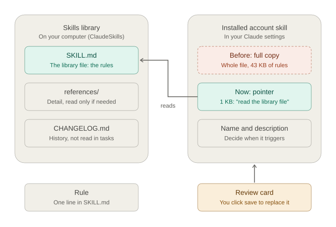
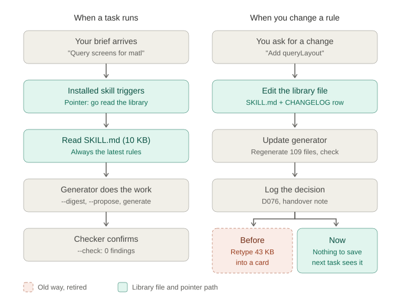

# Claude instructions: projects, chats, conversations and tasks

Reference note for using Claude in the ClaudeMES project, also for training others. Written 12 October 2026; section 7 (files shown at the bottom of a response) added 12 October 2026; section 11 (skills: library file, pointer, review card) added and sections 4, 8 and 10 updated 18 October 2026 for the token-saving method (D073).
This file is in `100_Self_Notes`, so it is a personal note and not project authority (see `project_working_rules.md` section 3). The binding handover rules are in section 7 of `project_working_rules.md`.

---

## 1. The terms

| Term | What it is | In this project |
|---|---|---|
| **Project** | A container on claude.ai with a name, a description, project instructions, project documents (the knowledge base) and project memory. Every chat and task opened inside the project can use it. | **ClaudeMES1**, "MES Software Architecture" |
| **Chat** | The conversational mode of Claude. You talk to Claude; it can read the project documents and answer, design, review and write text or code in its replies. | Discussions, design questions, reviews |
| **Conversation** | One single chat session: one thread of messages, from your first message to your last. Starting a "new chat" starts a new conversation. | One discussion topic |
| **Cowork** | The agent mode of Claude. Besides talking, Claude has its own temporary workspace (a Linux computer in the cloud with a shell, Python, file tools), can read and write project documents, can work in folders on your PC that you connect, can publish artifacts and can schedule tasks. | Generating and validating data, updating the register, writing files |
| **Task** | One single Cowork session: one thread of messages plus its own temporary workspace. Starting a "new task" starts a fresh session with an empty workspace. | One phase or work package |
| **Session** | The general word for a conversation (Chat) or a task (Cowork). | |
| **Connected folder** | A folder on your PC that you allow a task to read and write, for example `E:\Ivy\Claude\ClaudeProjects\ClaudeMES` or a subfolder of it. Access is granted per task. | The Git repository of the project |
| **Artifact** | A page Claude publishes on claude.ai with its own link (dashboards, documents, decks). It stays after the session ends and can be reopened or shared. | Not used much so far |

### How to tell whether you are in Chat or Cowork

Button names and layout change between app versions, so treat these as signs to look for rather than fixed labels.

| Sign | Chat | Cowork |
|---|---|---|
| **Where you started it** | "New chat" (desktop, web or phone app) | The **Cowork** tab or section of the desktop app, with "New task" |
| **Name in the sidebar** | Listed under chats or conversations | Listed under tasks |
| **Folder option** | No way to connect a folder from your PC | **Add folder** button, and connected folders are shown for the task |
| **What appears while Claude works** | Mostly just the answer, sometimes a web search or a document read | Step-by-step activity such as "Ran a command", "Read file" or "Wrote file", often with a progress or task list |
| **Side panel** | Mainly shows artifacts | Shows files, previews, artifacts and sometimes a browser |
| **What Claude can do** | Talk, write text and code in the reply, read project documents | All of that, plus run scripts, create and change files, and work in your connected folders |

**Quickest test:** ask *"Are you in Chat or Cowork?"* Claude knows which mode it's running in. Or ask it to list a connected folder. If it can, you're in Cowork.

---

## 2. When to use what

| Situation | Use |
|---|---|
| Asking a question, discussing an architecture choice, reviewing a design idea, getting an explanation | **Chat** (new conversation) |
| Anything that must produce, change or check files: generating sample data, running `gen_samples.py` / `gen_specs.py` / `flatten_model.py`, validating referential integrity, updating `data_model_register.md` or `decision_log.md` | **Cowork** (new task) |
| Working with files in `E:\Ivy\Claude\ClaudeProjects\ClaudeMES` | **Cowork** task with that folder connected |
| A new phase or work package | **New Cowork task**, one per phase (section 7 of `project_working_rules.md`) |
| A different, unrelated subject | **New** conversation or task, not the current one |
| A follow-up question on work just done in the same session | **Same** conversation or task |

Rule of thumb: **Chat for thinking, Cowork for doing.** Each new phase gets a new task.

---

## 3. What a NEW CONVERSATION (Chat) knows and does not know

### It HAS

- The project instructions (the ROLE, REFERENCE PRODUCT, DESIGN RULES and HOW TO WORK text in the project settings).
- The list of project documents, and it can read any of them (`data_model_register.md`, `decision_log.md`, `project_working_rules.md`, the generator scripts and so on). It reads them when it needs them; it does not know their content until it reads them.
- Project memory, if memory is turned on: short notes Claude has kept from earlier chats in this project. These are summaries, can be incomplete, and are not a substitute for the project documents.
- Your account details (name, email) and today's date.

### It does NOT have

- The messages of any earlier conversation or task. It cannot see what was said, decided or agreed there unless that was saved to a project document.
- Files you attached to earlier conversations or tasks.
- Files created in the workspace of an earlier task.
- Anything decided in an earlier session but not written into `decision_log.md`, `data_model_register.md` or another project document.
- Access to your PC folders (Chat cannot work with local files).
- The ability to run scripts or generate files on disk.

---

## 4. What a NEW TASK (Cowork) knows and does not know

### It HAS

- Everything a new conversation has: project instructions, the project document list (and can read every document), project memory if memory is on, your account details and today's date.
- A new, empty temporary workspace where it can run Python, generate files and run checks.
- The ability to write project documents back to the project.
- Access to folders on your PC **once you connect them in this task** (or approve Claude's access request).
- Artifacts you published earlier, which it can find by listing them.

### It does NOT have

- The messages of earlier tasks or conversations.
- The workspace files of earlier tasks. Each task's workspace is separate and is cleared after a period of inactivity.
- Files attached to earlier tasks or conversations.
- Folder access granted in an earlier task. Connect the folder again, or approve the access request when Claude asks.
- Anything decided earlier but not written to a project document or to your local Git folder.

### What this means in practice

A new conversation or task only knows what is in the **project documents** (and, roughly, in project memory). That is why every task must end by saving its results and a **Session handover note** to the project (section 7.3 of `project_working_rules.md`; since D073 the note is the separate file `00_governance/session_handover.md`, not the end of `decision_log.md`), and every new task starts with the brief:

> Task: <phase or work package name>. Goal: <the outcome required>. Inputs: <any new files or instructions>. Connect E:\Ivy\Claude\ClaudeProjects\ClaudeMES. Follow section 7 of project_working_rules.md.

This is the short form. For larger tasks, use the full brief in section 8.

---

## 5. When is a task getting too long

A session can hold only a limited amount of text (its "context"). When it fills up, older parts are automatically compacted, which means summarised. Details such as exact IDs, tolerances, key names and decisions can then be lost or blurred. Every message also reprocesses the whole history, so long sessions use up your limits faster.

Close the task (with the section 7.3 handover) and start a new one when **any** of these apply:

1. **The phase or work package is finished.** This is the normal point to stop.
2. **The subject changes** to something unrelated to the task's goal.
3. **Claude reports that the conversation was compacted or summarised**, or says earlier context is no longer fully available.
4. **Claude starts forgetting or contradicting earlier work**: asks for something already given, uses an old convention (for example snake_case plural names, `PREFIX-recordNo` IDs, UTC times, the old 28 Sept to 10 Oct timeline), or gets IDs or counts wrong.
5. **The task has handled a lot of large material**: several full generator scripts, the full register, large sample files or long outputs. Large documents fill the context much faster than short messages.
6. **Replies become noticeably slower** or the usage meter climbs quickly.
7. **As a guide, roughly 30 to 40 substantial exchanges**, or fewer when many large files were read. There is no fixed number; points 1 to 6 matter more.

You can also ask Claude: "How much of this task's context is used, should we hand over?" The `explain-usage` skill shows where the session's tokens went.

---

## 6. Where the knowledge is stored

### 6.1 Knowledge base of the entire project

| Store | Location | What it holds | Who reads it |
|---|---|---|---|
| **Claude project documents** | claude.ai, project **ClaudeMES1**, documents under `claude/` | The working copy Claude reads in every session: `project_working_rules.md`, `data_modeling_standard.md`, `mongodb_output_rules.md`, `data_model_register.md`, `decision_log.md` (with the latest Session handover note), `collection_keys.md`, `collection_inventory.md`, the generator scripts (`flatten_model.py`, `gen_specs.py`, `gen_samples.py`, `sample_universe.py`, `sample_rules.py`, `master_refs.py`, `keydict_text.py`, `keydict_num.py`, `entity_samples.py`, `ext_req01.py`, `ext_req01_samples.py`, `catalogue.py`, `keys.py`, `spec_rules.py`) and the reports | Every chat and task, automatically |
| **Claude project instructions** | claude.ai, project settings | The ROLE, REFERENCE PRODUCT, DESIGN RULES and HOW TO WORK text. Where they differ from the level 1 governance files, the governance files apply (section 4 of `project_working_rules.md`) | Every chat and task, automatically |
| **Project memory** | claude.ai, project memory (managed by Claude) | Short notes remembered from earlier chats. Not complete, not authoritative | Every chat and task, when memory is on |
| **Local Git repository** | `E:\Ivy\Claude\ClaudeProjects\ClaudeMES` | The owner's full master copy in the structure of `Folder_Guide.md` (00_governance, 02_architecture, 03_design, 04_reference_data, 05_generator, 08_validation, 99_Archive, 100_Self_Notes and so on), with full version history in Git | Only a Cowork task with the folder connected |

The **project documents** are what Claude actually remembers between sessions. The **Git folder** is the long-term master and version history. Keep the two in step: whenever a task changes a document, it saves it to the project and, when the folder is connected, to the Git folder too.

### 6.2 Knowledge base of a task

| Store | What it holds | How long it lasts |
|---|---|---|
| **Task conversation (context)** | Every message, instruction, file read and output in this task | The message history stays visible in the app, but only the current task can use it, and older parts are compacted when the task gets long |
| **Task workspace** | Files Claude created or copied while working (scripts run, generated samples, check results) | Temporary. Cleared after a period of inactivity. Never the only place for a finished file |
| **Files sent to you in the chat** | Deliverables shown in the conversation | Stay downloadable from that conversation only |
| **Connected folder on your PC** | Files Claude wrote into your folder | Permanent, they are on your disk |
| **Project documents written by the task** | Updated register, decision log, scripts | Permanent, visible to every later session |

A task's own knowledge (its conversation and workspace) **does not carry over** to the next task. Only what the task saved to the project documents or to your folder carries over.

---

## 7. Files shown at the bottom of a response

After Claude answers, cards can appear below the response. They look different because the files are stored in different places. The exact labels can vary with the app version; what matters is **where the file is**.

### 7.1 The four kinds of card

| Card | What it means | Where the file is | Lasts |
|---|---|---|---|
| **File card with Download / Open** | Claude built the file in its own temporary workspace and delivered it into the conversation | Only attached to this conversation (unless Claude also saved it elsewhere, see 7.2) | As long as the conversation exists. No other chat or task can see it |
| **Project document card** (no Download button) | Claude wrote or updated a document in the Claude project knowledge | In the project on claude.ai (here: ClaudeMES1). Open it from the project's document list | Permanent. Every chat and task in the project can read it |
| **Artifact card** (opens a page with its own claude.ai link) | Claude published a page: a dashboard, document, deck, tool | On claude.ai, in your artifact gallery | Permanent until deleted. Private until you share it |
| **No card, but Claude names a folder and file** | Claude wrote the file directly into a folder on your PC that is connected to the task | On your disk, for example `E:\Ivy\Claude\ClaudeProjects\ClaudeMES\00_governance` | Permanent. Nothing to download |

Files Claude only **read** or referred to may also be shown as references. Nothing new was created, so there is nothing to save.

### 7.2 Do I need to download it?

| Where the file is | Download? |
|---|---|
| Already written to your connected folder (Claude says the folder and file name) | **No.** It is already on disk. Commit it in Git |
| File card only, and Claude did **not** say it saved it to your folder | **Yes, if you want to keep it.** Otherwise it exists only inside this conversation |
| Project document only | **No for Claude** (every session reads it from the project). **Yes for your own copy** if you keep a master copy on disk, because the project and your folder do not synchronise by themselves. Better: ask Claude to write it to the folder too |
| Artifact | **No.** Reopen it from the gallery. If you want the source on disk, ask Claude to save its file in your folder as well |

**Quick rule:** if Claude's reply does not name a folder on your PC, the file is not on your PC.

### 7.3 Recommended way of working (so you rarely need to download anything)

1. Connect the project root folder at the start of every Cowork task. In ClaudeMES the task brief already contains "Connect E:\Ivy\Claude\ClaudeProjects\ClaudeMES." (section 7.1 of `project_working_rules.md`).
2. Ask Claude to save every finished file to its correct subfolder (per `Folder_Guide.md`) and, for governance and generator files, also to the project.
3. Check Claude's last reply: it should name the folder and file for each output. If a file appears only as a Download card, ask: "Save that file to the folder as well."
4. Commit the changed files in Git.
5. Do not download the same file several times or keep copies with version suffixes; Git keeps the history.

### 7.4 Project access and folder access are different

| | Project access | Folder access |
|---|---|---|
| What it gives | Read and write the project documents on claude.ai | Read and write files on your PC |
| How it is given | Automatically, to every chat and task in the project | Per task: click **Add folder** in the desktop app, or approve Claude's access request |
| Carries over to the next task | Yes | **No.** Connect the folder again in every new task |
| Available in Chat | Yes | **No.** Only Cowork can work with your folders |
| Needs your PC on | No | Yes. The Claude desktop app must be running on the PC the task is linked to; the approval prompt appears on that PC |

Connect the **root** folder (ClaudeMES), not single subfolders, so one approval covers every subfolder.

### 7.5 Common situations

| Situation | What to do |
|---|---|
| You worked in Chat and got a file card | Download it, or open a Cowork task and ask Claude to save it to the folder. Chat cannot write to your PC |
| A Cowork task gave you a file card but did not mention your folder | The folder was probably not connected. Connect it and ask Claude to save the file there |
| Claude updated a project document | Ask Claude to write the same file to its subfolder so the folder and the project match |
| You want to share a result with a colleague | Use an artifact (share its link) or send the file from your folder |
| An old conversation's file is needed in a new task | Download it from the old conversation and put it in the folder, or attach it to the new task. The new task cannot see the old conversation |

---

## 8. Writing a good task brief

The brief is the only thing a new task knows about your intention. Everything else it learns from the project documents. A good brief is short, but it answers every question Claude would otherwise have to guess.

### 8.1 The parts of a brief

| Part | What to write | Why it matters |
|---|---|---|
| **Task** | A short, unique name, e.g. "Pharma extension – impact analysis" | Used in the handover note and the decision log, so later tasks can refer to it |
| **Continues from** | The earlier task by name, and "read `00_governance/session_handover.md` (last decision D<nnn>)" | A new task cannot see the earlier task's conversation. Naming the last decision number shows Claude where the earlier work stopped; Claude checks it with `log_decision.py next` instead of reading the whole decision log |
| **Goal** | The outcome in one or two sentences, plus what is **in scope** and **out of scope** | Prevents Claude from widening or narrowing the work |
| **Context** | Industry, reference product, site, regulations, standards | Drives realistic data and correct terminology |
| **Fixed rules** | What must not change (conventions, IDs, existing collections) and which instruction wins if two conflict | Stops old or conflicting rules from coming back |
| **Inputs** | Exact file names and folder paths of new material, and which existing documents to start from | Claude reads only what it needs, so fewer tokens are used |
| **Outputs** | Each file to produce and the folder it goes into | Files land in the right place, not only in the chat |
| **Way of working** | For example, "do the impact analysis first and stop for my review" | Lets you approve the direction before large changes are made |
| **Done when** | Checks that must pass and the counts or files you expect | Tells Claude, and you, when the task is finished |
| **Standard closing lines** | "Connect E:\Ivy\Claude\ClaudeProjects\ClaudeMES and E:\Ivy\Claude\ClaudeSkills. Follow section 7 of project_working_rules.md." (ClaudeSkills is needed for UI and skill tasks, because the installed skills only point to the library files, section 11) | Folder access and the start-up and handover routine |

### 8.2 Template

```text
Task: <short unique name>
Continues from: <earlier task name>. Read 00_governance/session_handover.md (last decision D<nnn>).
Goal: <outcome in one or two sentences>.
  In scope: <list>
  Out of scope: <list>
Context: <industry, reference product, site, regulations>
Fixed rules: <what must not change>. If the project instructions conflict with this brief, this brief applies for this task; record the difference in decision_log.md.
Inputs: <file names with folder paths>; start from <existing documents>.
Outputs: <file> in <folder>; <file> in <folder>.
Way of working: <e.g. impact analysis first, then stop for my review>.
Done when: <checks and expected results>.
Connect E:\Ivy\Claude\ClaudeProjects\ClaudeMES and E:\Ivy\Claude\ClaudeSkills. Follow section 7 of project_working_rules.md.
```

### 8.3 Example: continuing the Data Model work for pharma

Before using this brief, decide two things, because they shape the whole task:

1. **Extend or separate.** Either the existing model becomes an industry-neutral core with a pharma extension (recommended: the conventions, the master data and most of the execution and quality collections are reusable), or pharma gets a separate model.
2. **Reference product.** The project instructions name the brake caliper. For pharma, the brief must name the pharma reference product and say that it applies to this task. Otherwise Claude will keep producing automotive data. If pharma becomes the main focus, change the project instructions too.

The product, site and process below are examples. Replace them with your own.

```text
Task: Pharma extension – impact analysis
Continues from: "Data Model" task. Read the latest Session handover note and decision_log.md (last decision D046), data_model_register.md and collection_inventory.md.
Goal: Assess what the existing MES data model (343 collections) needs in order to support pharmaceutical oral solid dose manufacturing, and propose the changes. No model or data changes in this task.
  In scope: master data, recipes and batch execution (ISA-88), electronic batch record, weighing and dispensing, in-process controls, equipment cleaning and line clearance, environmental monitoring, deviations and CAPA, QA batch release, serialisation and aggregation, data integrity and electronic signatures.
  Out of scope: clinical, R&D, LIMS internals, ERP finance, sample data generation.
Context: Reference product for this task: Metformin Hydrochloride Tablets IP 500 mg, film-coated, blister pack of 10 x 10, made at an oral solid dose plant in India. Process: dispensing -> sifting -> wet granulation -> fluid bed drying -> milling -> blending and lubrication -> compression -> film coating -> visual inspection -> blister packing -> carton packing with serialisation and aggregation -> QA release -> dispatch. Regulations and standards: 21 CFR Part 11, EU GMP Annex 11, revised Schedule M (India), GAMP 5, ISA-88, ISA-95, ALCOA+.
Fixed rules: All existing conventions stay (D002 naming, D003 flat documents, D029 16-digit IDs, D035 local plant time, D042 new collections numbered after the last one, D044 one BSON type per key name). Existing collection numbers and _id values do not change. For this task the pharma reference product replaces the brake caliper; record this in decision_log.md.
Inputs: <any pharma requirement documents, e.g. 01_research\pharma\pharma_requirements.xlsx>; start from data_model_register.md, collection_inventory.md, module_comparison_matrix.md and MES_ExternalRequirement_01_impact_analysis.md (use it as the pattern for the analysis).
Outputs: MES_Pharma_impact_analysis.md in 02_architecture, listing per collection: reuse as is / extend (keys to add) / new; proposed new collections with module code; open questions. Updated decision_log.md with the scope decisions.
Way of working: Impact analysis only. Stop after the analysis for my review; I will approve the collections before the model is changed in the next task.
Done when: every in-scope area maps to existing or proposed collections; every proposed key follows the modelling standard; counts of reused, extended and new collections are stated; the handover note names the next task.
Connect E:\Ivy\Claude\ClaudeProjects\ClaudeMES. Follow section 7 of project_working_rules.md.
```

Suggested follow-on tasks, one per task:

1. Pharma extension – model changes (apply the approved analysis to the generator sources; regenerate specifications).
2. Pharma extension – sample data (pharma batches over a two-week period).
3. Pharma extension – validation (integrity, type consistency, timeline, data integrity checks).

### 8.4 Tips

- One goal per task. If the brief needs two goals, it is two tasks.
- Name files and folders exactly; "the requirements file" makes Claude search, which costs tokens.
- Say what must **not** change as clearly as what must change.
- For large changes, ask for an analysis or plan first and stop for review.
- Keep briefs in a file (for example `100_Self_Notes\task_briefs.md`) so you can reuse and improve them.

---

## 9. Parking a task (starting a new task while another stays open)

Sometimes you need to start a new task while an existing one is not finished and you will continue it later.

### 9.1 What the new task gets and does not get

| The new task GETS | The new task does NOT get |
|---|---|
| Project instructions and every project document **as they are when it starts**, including whatever the open task has already saved | The open task's conversation: what was discussed, decided or agreed there, unless it was written into a document |
| Your ClaudeMES folder as it is on disk, once you connect it in the new task | Unsaved work: half-finished files in the open task's workspace, and files that appeared there only as Download cards |
| Project memory (short notes, not reliable detail), if memory is on | Decisions agreed but not yet in `decision_log.md` or `assumptions_log.md` |
| | Folder access (connect the folder again) |
| | A handover note for the open task (a task only writes one when it ends) |

### 9.2 Risks of two tasks side by side

1. **Overwriting each other's work.** When the old task resumes, its copy of a shared file (`decision_log.md`, `data_model_register.md`, `sample_rules.py`) is the version it read earlier. If it saves that copy, the new task's changes are lost.
2. **Duplicate numbers.** Both tasks may add the same decision number (e.g. D047) or the same new collection numbers.
3. **Handover note replaced.** Only the latest handover note is kept, so the second task to finish replaces the first one's note.
4. **Temporary workspace.** An idle task's workspace is cleared. The conversation stays, but unsaved workspace files do not.

### 9.3 How to do it safely

**Before switching**, tell the open task:

> Pause this task. Save all work in progress to the project and the folder, log open decisions, and write a parked note listing what is done, what is open, files changed and the last decision number.

**In the new task's brief**, add:

> Another task (<name>) is paused. Do not change <files it owns>. Take decision numbers from D<nnn+10> onward.

or keep the new task's work on different files.

**When you resume the old task**, tell it:

> Before continuing, re-read decision_log.md, data_model_register.md and any file changed since <date>; do not save from earlier copies.

---

## 10. Checklist

**Starting a task**
1. Open Cowork, choose project ClaudeMES1, click New task.
2. Paste the brief (full form in section 8): "Task: … Goal: … Inputs: … Connect E:\Ivy\Claude\ClaudeProjects\ClaudeMES and E:\Ivy\Claude\ClaudeSkills. Follow section 7 of project_working_rules.md."
3. Approve the folder access request when it appears (on the PC the task is linked to), or connect the folder yourself with Add folder. Folder access is per task; project access is automatic.
4. Check Claude's first reply: documents read, collection and key counts, last decision number, plan. For a UI task it should read only the handover note, the UI profile and the skill file, and use `gen_query.py --digest` / `--propose` instead of reading field lists (section 11.4).

**Ending a task**
1. Ask: "Close this task per section 7.3."
2. Check that the decision log, `session_handover.md`, the changed files (and the register, if the model changed) were saved to the project and to the Git folder.
3. Save any review card shown in the chat (section 11.3); a card that is not saved changes nothing.
4. Commit the changes in Git (ClaudeMES, and ClaudeSkills if a skill changed).
5. Copy the recommended brief for the next task from Claude's last reply.

## 11. Skills: library file, rule, pointer and review card

Added 18 October 2026 (decisions D073, D076). The skills that build UI configurations (`mes-query-control`, `mes-ivy-config`, `mes-stable-table`, `mes-menu-builder`) and `skill-library-sync` work this way.

### 11.1 The terms

| Term | What it is | Where it lives |
|---|---|---|
| **Skill** | The package of instructions for one kind of job, for example building query screens. It has two parts: the library file and the installed account skill. | Library folder and Claude settings |
| **Library file** | `SKILL.md` of the skill: the one authoritative copy of the rules. Every change is made here. Beside it: `references/` (detail read only when needed) and `CHANGELOG.md` (history, never read during normal work). | `E:\Ivy\Claude\ClaudeSkills\MintSkills\UiSkills\<skill>\` (and `ClaudeSkills\skill-library-sync\`) |
| **Rule** | One instruction inside the library file, for example "`queryLayout` is always `singleLine`" or "search dropdowns need 4 characters". | A line or table row in `SKILL.md` |
| **Installed account skill** | The copy Claude sees automatically in every task. Its name and description decide when the skill is used. | Claude settings, Skills |
| **Whole file (old way)** | The installed skill used to be a full copy of all the rules (43 KB for `mes-query-control`). Two copies of the same rules: every change had to be made twice. | Retired |
| **Pointer (short pointer version)** | The installed skill now: the name, the description and one instruction, "read the library file from the connected ClaudeSkills folder". About 1 KB. The library file is the single source of truth. | Claude settings, Skills |
| **Review card** | The box Claude shows in the chat when it proposes a new installed skill. Nothing changes in your settings until you click save. | In the chat |



### 11.2 What happens in a task and when a rule changes



**When a task runs** (left lane): your brief arrives; the installed skill triggers; because it is a pointer, Claude reads the library file `SKILL.md` (about 10 KB) from the connected ClaudeSkills folder, so it always uses the latest rules; the generator does the work (`gen_query.py --digest`, `--propose`, generate); the checker (`--check`) must report 0 findings.

**When you change a rule** (right lane): you ask for the change; Claude edits the library file and adds a `CHANGELOG.md` row; it changes the generator in the project and regenerates and checks the affected files; it records a decision (`log_decision.py add`) and updates the handover note. Before the pointers, Claude also had to retype the whole 43 KB file into a review card and you had to save it. Now nothing has to be saved: the next task reads the new rule.

### 11.3 When a review card is still needed

- When a skill's **name, description or library folder** changes, because those are the only things the pointer holds.
- When a new skill is created, or an old full-copy skill is converted into a pointer.
- Never for an ordinary rule change.

Until you save a pointer card, the installed skill stays the old full copy and does not see changes made in the library. The five pointer cards were proposed on 18 October 2026 (`mes-query-control`, `mes-ivy-config`, `skill-library-sync`, `mes-stable-table`, `mes-menu-builder`).

### 11.4 Keeping token use low

| Do | Instead of |
|---|---|
| Put "Connect … ClaudeSkills" in the brief of UI and skill tasks | Letting Claude work from an old installed copy |
| Let Claude read `session_handover.md` and the UI profile | Asking it to read every governance file in full |
| Let Claude use `gen_query.py --digest <module>` and `--propose <module>` | Reading field lists (60 KB per module) |
| Handle two or three modules in one UI task | One module per task with a full start-up each time |
| Ask for a rule change in one sentence ("add `queryLayout: singleLine` to `dictData.config`") | Pasting or re-sending skill files |

Details: `00_governance/decisions/token_optimization_review.md` and section 7 of `project_working_rules.md`.

